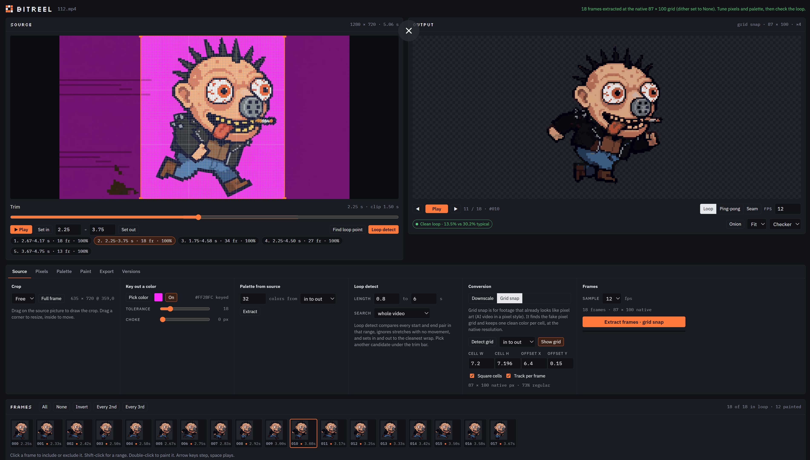

# BitReel

**Turn video into clean, looping pixel art.**

BitReel is a single-page browser tool that converts video footage into pixel-art animation loops. It handles live action, renders and AI-generated "pixel art style" video. It can build a whole character set (idle, run, jump…) in one project, and it exports GIFs, video, PNG frames, sprite sheets and a ready-to-import Unity package with one Animator Controller for the set.

Everything runs locally in your browser. Your video never leaves your machine.



---

## Contents

- [Features](#features)
- [Quick start](#quick-start)
- [Typical workflow](#typical-workflow)
- [Interface overview](#interface-overview)
- [Source panel](#source-panel)
- [Output panel](#output-panel)
- [Frame strip](#frame-strip)
- [Source tab](#source-tab)
- [Pixels tab](#pixels-tab)
- [Palette tab](#palette-tab)
- [Animation tab and animation sets](#animation-tab-and-animation-sets)
- [Paint tab and the paint editor](#paint-tab-and-the-paint-editor)
- [Export tab](#export-tab)
- [Project tab and .bitreel files](#project-tab-and-bitreel-files)
- [Unity integration](#unity-integration)
- [Keyboard shortcuts](#keyboard-shortcuts)
- [How it works](#how-it-works)
- [Limits and browser support](#limits-and-browser-support)
- [File formats](#file-formats)
- [Running locally and hosting](#running-locally-and-hosting)
- [Troubleshooting](#troubleshooting)
- [Credits and license](#credits-and-license)

---

## Features

- **Two conversion modes**
  - **Downscale** averages footage into blocks, for live action and 3D renders.
  - **Grid snap** detects the fake pixel grid in AI "pixel art style" video and recovers the art at its native resolution with crisp edges.
- **Loop tools**
  - **Loop detect** finds the cleanest loop anywhere in the clip and sets in and out points.
  - **Detect states** splits a clip with several actions (idle, run, jump, hit) into states and transitions, marks them on the trim bar and turns them into an animation set in one click.
  - **Find loop point** keeps your in point and finds the best matching out point.
  - **Seam check** measures how cleanly the last frame wraps into the first.
- **Background keying** with an eyedropper, tolerance and edge choke. Fringe and blended edge colors are cleaned automatically in grid snap.
- **Palettes**
  - Built-in retro presets.
  - Palettes extracted from the source or from extracted frames.
  - Full per-swatch editing, a transparent swatch, and hex import and export.
- **Dithering**: none, Bayer 2×2, 4×4 and 8×8, Floyd-Steinberg, Atkinson.
- **Motion-aware flicker reduction**: stability, temporal smoothing and one-frame pop removal, all of which leave real motion alone.
- **Full-screen paint editor**
  - Pencil, eraser, restore, fill, picker and hand tools.
  - Zoom from ×1 to ×64, a pixel grid, onion skin and playback.
  - Undo and redo, and an option to paint all selected frames at once.
- **Frame selection**: include or exclude frames, select ranges, thin to every 2nd or 3rd frame.
- **Animation sets**: several animations in one project (idle, run, jump…) that share the palette and look, each with its own frames, trim, frame rate and edits.
- **Stabilize in place**: locks the character horizontally and/or by the feet, so walk and run cycles play on the spot like game sprites.
- **Trim to content**: crops every frame to the tightest box around the character, optionally with one shared frame size and anchor across the whole set.
- **Its own project format, `.bitreel`**: one file on your disk with the frames, every setting, painted edits and all saved versions. Save with Ctrl/⌘ + S.
- **Exports**
  - Animated GIF, MP4 or WebM, PNG frames, sprite sheet.
  - A Unity package for the whole set: one sprite sheet and looping AnimationClip per animation, all as states of one Animator Controller, with the pivot at the character's feet.
- **Up to 60 fps** sampling and playback.

---

## Quick start

1. Open `bitreel.html` in a recent Chrome, Edge, Firefox or Safari, or use the hosted GitHub Pages demo.
2. Drop a video on the **Source** panel, or click **Choose video**.
3. BitReel checks the clip for a pixel grid.
   - If it finds one, it switches to **Grid snap** and tells you the cell size.
   - Otherwise it uses **Downscale**.
4. Drag on the source picture to set the crop.
5. Click **Loop detect** under the trim bar to find a clean loop, then press **▶ Play** to preview it.
6. In the **Source** tab, click **Extract frames**.
7. Adjust the look in **Pixels** and **Palette**. Fix anything by hand in the **Paint** editor.
8. Export from the **Export** tab.

The page opens with a procedural sample loop, so every tool can be tried before loading footage.

---

## Typical workflow

### Live action or renders (Downscale)

1. Load the video and crop to the subject.
2. Set the trim with **Loop detect** or the in and out points. Check it with **▶ Play**.
3. Pick a **Sample** rate (fps) in the Source tab and **Extract frames**.
4. In **Pixels**, choose an output **Width** (steps of 16), then tune contrast, saturation and dithering.
5. In **Palette**, choose a preset or rebuild a palette from the frames.
6. Turn on **Stability** if the result shimmers.
7. Check the **Seam** pill, then export.

### AI pixel-art video (Grid snap)

1. Load the clip. BitReel detects the grid and switches to **Grid snap** on its own when the grid is clear.
2. If the footage has a solid background, pick it with **Key out a color** *before* extracting. The fringe cleanup happens during extraction.
3. Check the grid overlay on the source. The lines should sit on the fake pixels. Adjust **Cell W / Cell H / Offset** if needed.
4. **Extract frames**. Frames come out at the native resolution, for example 91 × 100. Dither is set to None.
5. Use **Palette from source** to build a palette from the clip, skipping the background.
6. Clean up stray pixels in the paint editor, then export.

### A character set for a game

If one video holds every action (idle, then run, then jump, and so on), click **Detect states** under the trim bar and skip to step 4. See [Detect states](#detect-states).

1. Load the video and key out the background. Stabilize and trim both need transparency.
2. Set in and out on the first action, extract, and name the animation in the **Animation** tab (for example `idle`).
3. Click **+ New animation** in the Animations bar. It keeps the loaded video, so you can set in and out on the next action and extract again (`run`). Loading another video also starts a new animation.
4. For walk and run cycles, turn on **Stabilize** (lock horizontal, lock feet) so they play on the spot.
5. Build the palette once. It's shared, so every animation matches.
6. In **Export**, keep **Trim to content** and **Same size and anchor for all animations** on, set the pivot to **Feet (anchor)**, name the set (`hero`) and export the **Unity package** with **All animations**.

---

## Interface overview

```
┌──────────────────────────┬──────────────────────────┬────────────┐
│ SOURCE                   │ OUTPUT                   │ STATES     │
│ video, crop, grid        │ pixel-art loop preview   │ after      │
│ trim bar, state marks    │ playback, seam check     │ Detect     │
│ Play, Loop detect,       │                          │ states:    │
│ Detect states            │                          │ rows, ↑ ↓  │
├──────────────────────────┴──────────────────────────┴────────────┤
│ Source · Pixels · Palette · Animation · Paint                    │
│ Export · Project                                                 │
├──────────────────────────────────────────────────────────────────┤
│ ANIMATIONS: idle · run · jump · + New                            │
│ FRAMES: thumbnail strip, selection tools                         │
└──────────────────────────────────────────────────────────────────┘
```


The **Source** and **Output** panels are always visible. After **Detect states**, a narrow **States** column joins them on the right. Tools are grouped in tabs underneath. On narrow screens the panels stack.

The header shows the open project file (a dot means unsaved changes) and a status line that reports what each action did, along with any errors.

---

## Source panel

Shows the loaded video with the crop rectangle, the rule-of-thirds guides, and the pixel grid when Grid snap is on.

### Cropping

- **Drag on empty space** to draw a new crop.
- **Drag a corner handle** to resize.
- **Drag inside** the crop to move it.
- The aspect lock and **Full frame** reset are in the Source tab.

### Trim bar

| Control | What it does |
|---|---|
| Playhead slider | Scrubs the source. |
| **▶ Play / ■ Stop** | Plays the clip in real time between in and out, looping back to the in point. Shortcut: **P**. |
| **Set in / Set out** | Sets the in or out point to the playhead. Works during playback. |
| In / out fields | Type exact times in seconds. |
| **Find loop point** | Keeps the in point and moves the out point to the frame that best matches it. Click again to stop. |
| **Loop detect** | Searches start and end pairs for the cleanest loop and sets both points. Click again to stop. |

Playback stops on its own when you scrub, extract, or run a detection.

> The jump from out back to in requires a video seek, so a short hold at the wrap during source playback is normal. Extracted frames have no such pause. Use the Output panel's **Loop** or **Seam** modes to judge the real wrap.

### Loop detect candidates

After **Loop detect**, up to five candidates appear under the trim bar, for example `1. 2.67–4.17 s · 18 fr · 100%`.

- Click a candidate to apply it.
- Press **▶ Play** to preview it.

Each candidate shows its start and end, the frame count at your sampling rate, and how closely the end matches the start.

### Detect states

Generated sprite videos often chain several actions in one clip: idle, a short transition, run, back to idle, jump, hit. **Detect states** finds them for you.

1. Crop to the character and key out the background first. Detection only looks inside the crop, and the key helps it see the character's outline.
2. Click **Detect states** next to **Loop detect**. It samples the clip at the sampling rate.
3. Results show in three places:
   - **The trim bar** gets a colored band per state, with its best loop outlined and labeled. Transitions are hatched.
   - **Chips** under the trim bar list each state and transition, for example `run · 4.33–4.83 s · 6 fr · 100%`.
   - **The States column**, a narrow panel to the right of the Output panel, lists every state and transition as a row you can rename, check or uncheck.
4. Click **Create animations (N)** at the bottom of the States column. Each checked row becomes an animation in the set, extracted with your current crop, key and conversion settings.

### Comparing states

The States column is built for going back and forth between states:

- **Click a row** (or a mark on the trim bar, or a chip) to select it. The source jumps to that range and loops it when **Play on select** is on. Once the state has an animation (marked `● anim`), the Output panel switches to that animation, so source and result play side by side. Repeats of an action show the same animation.
- **↑ and ↓** at the top of the column, or **Alt+↑ / Alt+↓** anywhere on the page, step to the previous or next state or transition.
- Under 1180 px wide, the column moves below the viewers. On phones it stacks with them.

How states are labeled:

| Label | Meaning |
|---|---|
| `loop` | The state repeats. Its best single cycle is picked and the match percentage shows how cleanly it wraps. |
| `once` | The state doesn't repeat (a hit or a landing). The whole state is used and the animation is marked **Plays once**. |
| `again` | The same action shown earlier in the clip. Repeats are listed but unchecked, so you get one `idle`, not three. |
| `transition` | The frames between two states, named `from_to_to` (for example `run_to_idle`). Unchecked by default. Check them to export transition clips. |

Names are guesses: the action that keeps coming back is `idle`, the one with the most vertical travel is `jump`, the busiest loop is `run`, and the rest are `action 1`, `action 2` and so on. Rename them in the list before creating. Transition names follow the new names.

**Merge with…** joins a state with any other state you pick from its menu. Use it when one action was split in parts, for example a hit made of a hurt flinch followed by a pose. States in between are merged in too, and the menu shows how many (`+2 between`). The merged state keeps the name of the row you merged from.

**States** in [Loop detect settings](#loop-detect-settings) sets how readily a change counts as a new state: **Fewer, bigger states**, **Normal** or **More, finer states**. Changing it re-runs detection on the cached samples without re-reading the video.

---

## Output panel

Shows the converted animation at the current settings. The header shows the conversion mode, the output size and the zoom, for example `grid snap · 91 × 100 · ×4`.

| Control | What it does |
|---|---|
| ◀︎ / ▶︎ | Steps one frame back or forward and pauses. |
| **Play / Pause** | Plays the selected frames. Shortcut: **Space**. |
| Frame readout | Position in the loop and the frame number. |
| **Loop** | Plays the selected frames in order, wrapping from last to first. |
| **Ping-pong** | Plays forward then backward. No seam. |
| **Seam** | Repeats only the frames around the wrap and shows the last and first frames side by side. |
| **FPS** | Playback rate, 1 to 60. Also used by every export. |
| **Onion** | Ghosts the previous frame over the current one. |
| Zoom | **Fit** (largest whole-number scale that fits), or ×1 to ×8. |
| Background | Checker, black or white, to judge transparency. |

### Seam pill

Compares the change between the last and first selected frames with the typical change between consecutive frames:

- **Clean loop** means the wrap is no bigger than a normal step.
- **Visible seam** means it's up to 3× a normal step.
- **Seam jump** means it's larger than that.

### Empty state

When a new video is loaded, the Output panel is cleared and shows **No frames yet**, with a button to the Source tab. If the current animation already has frames, loading a video starts a **new animation** for it, and the earlier ones stay in the set. Your settings are kept.

---

## Frame strip

The top row is the **Animations bar**: one chip per animation in the project, with its frame count. Click a chip to switch, double-click to rename, or click **+ New animation**. See [Animation tab and animation sets](#animation-tab-and-animation-sets).

Below it is a thumbnail of every extracted frame of the current animation, with its index and source time.

- **Click** a frame to include or exclude it from the loop. Excluded frames are dimmed and struck through.
- **Shift-click** applies the same state to the range since your last click.
- **Double-click** opens the frame in the paint editor.
- A dot after the frame number marks a painted frame.
- **All / None / Invert / Every 2nd / Every 3rd** change the selection in bulk.

Only selected frames are played, seam-checked, flicker-reduced and exported.

---

## Source tab

### Crop

- **Aspect lock**: Free, 1:1, 4:3, 16:9, 9:16, 2:1.
- **Full frame** resets the crop.

### Key out a color

Makes a background color transparent.

1. Click **Pick color**, then click the background in the source picture. A 3×3 area is averaged.
2. Adjust the two sliders:
   - **Tolerance** (1 to 100) sets how far from the picked color still counts as background.
   - **Choke** (0 to 3 px) grows the transparent area to trim edge pixels.
3. Use **On / Off** to toggle the key without losing the color.

How each mode treats the key:

- **Downscale**: keyed pixels are left out of each block's average, so background color doesn't tint edges. A block becomes transparent when more than half of it is keyed.
- **Grid snap**: keyed pixels and *fringe* are left out when choosing each cell's color. Fringe means colors near the key, or with the key's hue at any brightness, such as magenta blended with a black outline. A cell that is mostly background becomes transparent.

Set the key before extracting in Grid snap mode, because the cleanup happens during extraction.

### Palette from source

Builds a palette directly from the video.

- **Colors**: 2 to 64.
- **From**: the frame on screen, or 10 frames spread between in and out.

The crop, the current Pixels adjustments and the key are all applied first. Background and fringe colors don't use up palette slots.

### Loop detect settings

- **Length**: shortest and longest loop in seconds. Default 0.8 to 6 s.
- **Search**: the whole video, or only between the current in and out.
- **States**: how readily **Detect states** splits the clip. Fewer, bigger states; Normal; or More, finer states.

### Conversion

- **Downscale**: box-averages the crop down to the output width. For live action and renders.
- **Grid snap**: for footage that already looks like pixel art. Recovers one clean color per fake pixel at the native resolution.

#### Grid snap controls

| Control | What it does |
|---|---|
| **Detect grid** | Measures the grid from this frame, or from this frame plus 5 frames between in and out. |
| **Show grid** | Toggles the grid overlay on the source. |
| **Cell W / Cell H** | Cell size in source pixels, from 1.5 to 128. Fractional sizes like 7.2 are normal for AI video. |
| **Offset X / Y** | Where the first cell starts inside the crop. |
| **Square cells** | Locks Cell H to Cell W. |
| **Track per frame** | Re-aligns the grid on each frame when it clearly moved, and snaps single lines to strong edges that agree with their neighbors. Steady footage stays on the detected grid. |
| Readout | Native size, for example `91 × 100 native px`, and how regular the grid is. |

When a video loads, BitReel samples three frames. If it finds a clear grid between 3 and 48 px, it switches to Grid snap. Otherwise it uses Downscale. The status line says which one it chose. The mode is remembered between sessions.

### Frames

- **Sample**: 6, 8, 10, 12, 15, 24, 25, 30, 48, 50 or 60 fps.
- The estimate shows the frame count and the working or native size.
- **Extract frames · downscale / grid snap**: the label always shows which mode will run.

Extraction samples frames at `in + k / fps` and stops before the out point. The output FPS is set to the sampling rate.

---

## Pixels tab

### Size and tone

| Control | Range | Notes |
|---|---|---|
| **Native grid resolution** | on/off | Only after a grid-snap extraction. Uses the recovered size exactly. |
| **Width** | 16 to 400, steps of 16 | Height follows the crop's aspect ratio. Crop to 1:1, 16:9 or 2:1 for clean numbers. |
| **Brightness** | -100 to 100 | |
| **Contrast** | -100 to 100 | Default 10. |
| **Saturation** | -100 to 100 | Default 10. |
| **Gamma** | 0.50 to 2.00 | |

### Dither

- **None** gives flat color areas. Best for native pixel art.
- **Bayer 2×2, 4×4, 8×8** are ordered patterns. They stay fixed from frame to frame, so they don't shimmer. Default is 4×4.
- **Floyd-Steinberg, Atkinson** are error diffusion. They look finer on stills but shimmer in motion.
- **Strength** goes from 0 to 100.

### Flicker

The pill shows the share of pixels that change color per frame, before and after reduction, for example `6.5% → 4.1% change/frame`.

| Control | What it does |
|---|---|
| **Stability** (0 to 100, default 35) | A pixel keeps its previous color while it still matches closely, but only if the footage under it barely changed. Real motion updates normally, so moving subjects don't smear. |
| **Smoothing** (0 to 100, default 0) | Blends each frame with its neighbors before conversion. Useful for grainy footage. Softens fast motion. |
| **Remove one-frame pops** (default on) | Clears a pixel that flashes to another color for a single frame, but only when the source agrees it was noise. |

All three work on the selected frames as a loop, so the wrap is stabilized too.

---

## Palette tab

### Colors

- **Presets**:
  - PICO-8 (16)
  - Sweetie 16 (16)
  - Game Boy (4)
  - C64 (16)
  - CGA 4 (4)
  - Grayscale 8 (8)
  - 1-bit (2)
  - Custom
- **Swatches**: click to select one.
- **Swatch editing**:
  - The color picker and hex field edit the selected swatch.
  - **Transparent** marks it as transparent in exports and the preview.
  - **Remove** deletes it. At least 2 colors remain.
  - **Add** duplicates it. Up to 255 colors.

Any edit switches the preset to **Custom**. Palettes are remembered between sessions.

### Rebuild

- **From extracted frames**: median cut plus k-means on the selected frames, using 2 to 64 colors. Keyed pixels are skipped.
- **Sort by light** orders swatches by perceptual lightness (OKLab L).

### Hex list

Paste any text that contains 6-digit hex colors (`1a1c2c 5d275d …`) and click **Apply list**. **Copy** copies the current palette as hex.

Colors are matched in the OKLab color space, so the nearest palette color is the one that looks closest, not just the one with the closest RGB numbers.

---

## Animation tab and animation sets

A project can hold several animations, for example `idle`, `run` and `jump` for one character.

**Shared by every animation**, so a set looks consistent:
- the palette and transparent swatch
- the key
- Pixels settings (size, tone, dither, flicker)
- export settings

**Kept per animation:**
- frames and frame selection
- source trim and crop
- conversion mode and grid
- frame rate and loop mode
- painted edits and undo history
- stabilization

### This animation

| Control | What it does |
|---|---|
| **Name** | The animation's name, used for its file names and as its state name in Unity. |
| **New animation** | Starts an empty animation that keeps the loaded video and its trim, so you can extract another range. Same as **+ New animation** in the Animations bar. |
| **Duplicate** | Copies the animation, frames and edits included, for example to try another stabilization. |
| **Delete** | Removes the animation from the project, after a second click. The last one can't be deleted. |
| **Plays once** | Marks a one-shot action (hit, death, landing). In Unity its clip doesn't loop. **Detect states** sets it for one-shot states and transitions. |

Loading a video while the current animation has frames starts a new animation named after the file.

### Stabilize

Keeps the character on the spot, so a cycle shot moving across the frame plays in place, the way game sprites need.

| Control | What it does |
|---|---|
| **Lock horizontal position** | Shifts each frame so the character's horizontal center of mass stays at the loop's median position. |
| **Vertical: Lock feet to the ground line** | Shifts each frame so the lowest row of the character (ignoring single stray pixels) stays on one line. This also removes the bob of a run cycle. |
| **Vertical: Lock center** | Keeps the vertical center of mass steady instead, which keeps the feet's up and down motion. |

- The pill shows how far frames were moved, for example `on · up to 19 px across, 1 px up/down`.
- Stabilization tracks the opaque pixels, so it needs transparency: **key out the background** or mark a transparent swatch first. Without it, the pill reads **needs transparency**.
- Frames move by whole pixels, so the pixel art stays crisp.
- Paint edits are applied on top of the stabilized frames. Changing stabilization afterwards moves the picture under existing edits.
- Each frame's offset is written to the Unity manifest (`stabilizeOffset`), in case you want to drive root motion from code.

### Set

Lists every animation with its frame count and frame rate.
- Click a name to switch to it.
- Use ↑ and ↓ to reorder. The first animation becomes the **default state** of the Unity controller.

---

## Paint tab and the paint editor

Open the editor with **Open paint editor** or by double-clicking a frame in the strip. It opens full screen on the frame shown in the Output panel.

### Top bar

| Tool | Key | What it does |
|---|---|---|
| **Pencil** | B | Paints with the selected palette color. |
| **Eraser** | E | Paints transparent. |
| **Restore** | R | Returns pixels to their converted color, removing edits. |
| **Fill** | G | Floods a connected area of the same color. |
| **Pick** | I | Picks a color from the frame. Picking a transparent pixel switches to Eraser. |
| **Hand** | H | Pans the view. |

- The color chip shows the current color.
- **Brush size**: 1, 2, 3, 4 or 6 px.
- **All selected frames**: each stroke or fill applies to every selected frame. Good for fixing something static.
- **Undo / Redo** keep up to 80 steps.
- **Clear edits** removes all edits on the current frame, or on the selected frames when *All selected frames* is on. You can undo it.
- **Done** closes the editor. **Esc** works too.

### Bottom bar

- **▶ Play / ■ Stop** plays the animation inside the editor at the output FPS, following Loop or Ping-pong. Painting, stepping or closing stops it. Shortcut: **P**.
- **◀︎ / ▶︎** step frames. The arrow keys do the same.
- **Onion** ghosts the previous frame.
- **Grid** shows the pixel grid from ×6 zoom up.
- **Palette strip** sets the color with one click.
- **Zoom**: **−**, **+** and **Fit**. The mouse wheel zooms at the cursor.
- **Cell readout** shows the coordinates of the pixel under the cursor.

### Navigation

- **Wheel** zooms around the cursor, from ×1 to ×64.
- **Shift + wheel** pans horizontally.
- **Space + drag**, **middle mouse drag** or the **Hand** tool pans freely.

### How edits are stored

- Edits are stored as **colors**, not palette slots. They survive palette changes, dither changes, flicker settings and palette rebuilds. Each painted color is re-matched to the current palette.
- Edits are kept **per output size**. Changing the width hides them until you return to that size.
- Painted frames are marked in the frame strip and listed in the Unity manifest.
- Edits are saved in versions and project files.

---

## Export tab

### Settings

| Setting | Applies to | Notes |
|---|---|---|
| **Set name** | All | Names the export folder, the Unity controller and file names. Files are named `set_animation`, for example `hero_run_sheet.png`. |
| **Scale** | GIF, video, PNG frames, sprite sheet | 1, 2, 4, 6 or 8×, nearest-neighbor. Unity exports are always 1:1. |
| **Pixels / unit** | Unity | Default 16. |
| **Pivot** | Unity | **Feet (anchor)** (default), bottom center, center or bottom left. |
| **Sheet columns** | Sheets, Unity | 0 means automatic (√n). |
| **Padding** | Sheets, Unity | 0, 1 or 2 px between frames. |
| **Video loops** | Video | 1, 4, 8 or 16 repetitions. |

All exports use the **selected** frames, in order, at the animation's **FPS**. Ping-pong mode also plays frames back in reverse in GIF, video and Unity exports.

### Sprite frame

| Setting | What it does |
|---|---|
| **Trim to content** (default on) | Crops every frame to the tightest box around the opaque pixels across the whole loop, so sprites carry no empty margins. Needs transparency, otherwise the full frame is kept. |
| **Same size and anchor for all animations** (default on) | Gives every animation in the set one shared frame size and places each one so its anchor lands on the same pixel. Switching from idle to run then doesn't make the sprite jump. |
| **Margin** | 0, 1, 2 or 4 transparent pixels around the trimmed box. |

The **anchor** is the character's horizontal center of mass, on the ground line (the lowest the feet reach in the loop). With the **Feet (anchor)** pivot, the Unity pivot sits exactly there. The readout under the heading shows the resulting frame size and pivot, for example `46 × 37 shared · pivot 0.52, 0.00`.

Trimming applies to every export, so GIFs, videos and PNG frames are cropped the same way.

### Formats

| Button | Output |
|---|---|
| **Unity package (.zip)** | **Include: All animations** (default) or **This animation**. One sprite sheet, manifest and frame folder per animation, the shared palette, and the editor importer. See [Unity integration](#unity-integration). |
| **Sprite sheet .png** | The current animation's frames in a grid at the chosen scale. |
| **PNG frames .zip** | One PNG per frame of the current animation at the chosen scale. |
| **Animated .gif** | Exact palette with no re-quantization. Loops forever. Transparent pixels stay transparent. |
| **Video** | MP4 (H.264) where the browser can record it, otherwise WebM. Recorded in real time. Transparent pixels become black. |

> **GIF timing:** GIF delays are in hundredths of a second, and browsers slow down delays under 2/100 s. GIFs therefore play at most 50 fps. Video, PNG and Unity exports keep the full FPS.

---

## Project tab and .bitreel files

BitReel saves your work in its own file format, **`.bitreel`**, on your computer. It doesn't depend on any account, server or browser storage. A project file holds everything needed to pick the work up again, including every saved version.

### Project file

| Control | Shortcut | What it does |
|---|---|---|
| **Project name** | | Used as the file name. The header shows the file, with a dot while there are unsaved changes. |
| **Save** | Ctrl/⌘ + S | Writes the project. The first save asks where. After that, Save writes back to the same file. |
| **Save as…** | Ctrl/⌘ + Shift + S | Writes a copy under a new name or location. |
| **Open…** | Ctrl/⌘ + O | Opens a `.bitreel` file. You can also drop one anywhere on the page. |
| **New** | | Starts over. Your settings are kept. |

How saving works depends on the browser:

- **Chrome and Edge** write straight to the file on disk through the File System Access API, like a desktop app.
- **Firefox and Safari** download the file. Save again to download an updated copy.

Opening, New and closing the tab warn you when there are unsaved changes. Opening and New ask for a second click.

### What a project contains

- **every animation in the set**, each with:
  - its extracted frames and frame selection
  - its crop and trim (in, out, sampling rate)
  - its conversion mode and grid settings
  - its frame rate and loop mode
  - its painted edits
  - its stabilization
- the shared key, Pixels and flicker settings
- the shared palette and transparent swatch
- export settings
- every saved version

The **source video is not stored**, which keeps project files small. Load the video again if you want to re-crop or re-extract. If you load the same file name, the crop and trim are restored too.

### Versions

A version is a named snapshot kept **inside the project file**.

- **Save version** adds a snapshot of the whole set, every animation included. Name it or keep the automatic name. Press Enter to save.
- Each version shows:
  - a thumbnail
  - the time
  - the number of animations and frames
  - the number of colors and painted frames
- **Load** restores that version. **Delete** removes it. Both ask for a second click.
- Versions become permanent when you save the project.

Versions that share the same extracted frames share one copy of those frames in the file. Ten versions with different palettes cost little more than one.

Older `.zip` project files from earlier builds (Pixelbench and BitReel) still open.


---

## Unity integration

### Package contents

For a set named `hero` with `idle` and `run`:

```
hero_unity.zip
├── hero/
│   ├── hero_idle_sheet.png          sprite sheet per animation, 1:1 pixels
│   ├── hero_idle.pixelsheet.json    manifest per animation
│   ├── hero_run_sheet.png
│   ├── hero_run.pixelsheet.json
│   ├── hero_palette.png             shared palette, N×1
│   ├── hero.hex                     shared palette as hex, one color per line
│   └── frames/
│       ├── idle/hero_idle_000.png …
│       └── run/hero_run_000.png …
├── Editor/
│   └── PixelSheetImporter.cs        editor importer (install once)
└── README.md                        import notes and a table of the animations
```

When the set name and the animation name are the same, the animation's files use the set name alone.

### Importing

1. **Install the importer once.** Copy `Editor/PixelSheetImporter.cs` to `Assets/Editor/PixelSheetImporter.cs`.
   - Skip this if it's already in the project. Two copies won't compile.
   - It needs the **2D Sprite** package (`com.unity.2d.sprite`), which ships with the 2D templates.
2. **Copy the `hero/` folder** anywhere under `Assets/`, for example `Assets/Art/Characters/hero/`.
3. The importer runs on its own for each `.pixelsheet.json`. For each animation it:
   - sets the sheet to Sprite (Multiple), Point filter, no compression, no mipmaps, clamp wrap, and the manifest's pixels per unit
   - slices one sprite per frame, named `hero_run_000`, `hero_run_001`, …, with the manifest's pivot (it keeps sprite IDs stable on re-import)
   - creates or updates `hero_run.anim`, a looping clip on `SpriteRenderer.m_Sprite` at the animation's FPS, including ping-pong
   - adds or updates a state named `run` in **`hero.controller`**, creating the controller on the first animation. The first animation of the set is the default state.

Exporting a single animation later (**Include: This animation**) into the same folder adds or updates just that state.

### Re-running the importer

- From the menu: **Tools › BitReel › Import Selected Sheet**, with the JSON selected.
- From code:
  ```csharp
  PixelSheetImporter.Import("Assets/Art/Characters/hero/hero_run.pixelsheet.json");
  ```
  The console logs `[BitReel] Imported hero_run: N sprites at F fps -> path`.

### Using it with Claude and the Unity MCP

The package is laid out so an assistant with Unity MCP access can import it unattended:

1. Check whether a `PixelSheetImporter` class already exists. If not, create the script and wait for compilation.
2. Copy the folder into `Assets/` and refresh the AssetDatabase.
3. If clips don't appear, call `PixelSheetImporter.Import(path)` for each JSON through code execution and check the console for the `[BitReel] Imported` lines.
4. To place the character in a scene, create a GameObject with a `SpriteRenderer` (sprite `hero_idle_000`) and an `Animator` that uses `hero.controller`. Switch animations with `animator.Play("run")`, or add transitions between the states.

### Manual import (without the importer)

1. Texture Type **Sprite (2D and UI)**, Sprite Mode **Multiple**, Filter **Point**, Compression **None**, mipmaps off.
2. Slice by **Cell Size** using the manifest's `frameWidth × frameHeight`, offset 0, padding as in the manifest, and set the pivot to the manifest's `pivotX`, `pivotY`.
3. Build an AnimationClip at the manifest FPS from the sprites in order. For ping-pong, follow them with the same sprites in reverse, leaving out the first and last.
4. Add each clip as a state of one Animator Controller.

---

## Keyboard shortcuts

### Main page

| Key | Action |
|---|---|
| **Space** | Play or pause the output |
| **← / →** | Previous or next output frame |
| **P** | Play or stop the source loop (between in and out) |
| **Alt + ↑ / ↓** | Previous or next detected state (after Detect states) |
| **Ctrl/⌘ + S** | Save the project |
| **Ctrl/⌘ + Shift + S** | Save the project as… |
| **Ctrl/⌘ + O** | Open a project |
| **← / →** on the tab bar | Switch tabs |

### Paint editor

| Key | Action |
|---|---|
| **B / E / R / G / I / H** | Pencil, eraser, restore, fill, pick, hand |
| **+ / − / 0** | Zoom in, zoom out, fit |
| **Wheel** | Zoom at the cursor |
| **Shift + wheel** | Pan horizontally |
| **Space + drag**, middle mouse | Pan |
| **← / →** | Previous or next frame |
| **P** | Play or stop the animation |
| **Ctrl/⌘ + Z** | Undo |
| **Ctrl/⌘ + Shift + Z**, **Ctrl/⌘ + Y** | Redo |
| **Esc** | Close the editor |

---

## How it works

### Pipeline

```
video ─▶ crop ─▶ sample frames ─▶ [Downscale | Grid snap] ─▶ adjust (brightness, contrast,
saturation, gamma) ─▶ key mask ─▶ quantize to palette (OKLab) + dither ─▶ flicker reduction
─▶ stabilize ─▶ painted edits ─▶ preview ─▶ (export) trim and shared frame layout
```

- **Animations.** The pipeline runs on the current animation. At export, other animations are run through the same shared settings, so the whole set matches.

- **Work frames.** Downscale mode stores frames at up to 400 px on the long side. Grid snap stores them at their native size.
- **Live updates.** Changing a setting re-runs only the stages after it, so updates feel immediate.

### Downscale

Each output pixel is the area average of its block of source pixels. Keyed pixels are left out of the average, so background color doesn't bleed into edges.

### Grid detection

1. Edge strength is summed along each axis to build a profile whose peaks sit on cell boundaries.
2. A high-pass filter removes smooth gradients.
3. Candidate periods from 2 to 64 px are scored by spectral strength. Each sampled frame is scored on its own, so a grid that shifts between frames doesn't blur the measurement.
4. Harmonics (p/2, p/3) score as high as the true period, so the largest strong period wins. It is then halved while the in-between lines still carry real edges, which handles art whose outlines mostly fall on every other line.
5. The period is refined to 0.002 px, and the offset is fitted directly to the edge lines.
6. Each axis keeps its own measurement. AI footage is often slightly non-square, and averaging the two would drift over many rows.

### Grid snap extraction

- **Per-frame alignment.** With *Track per frame* on, a frame's grid shifts only if that clearly fits better than the detected offset. Single lines move only onto strong edges that agree with their neighbors.
- **Cell color.** Each cell's color is the **dominant** color in the middle 50% of the cell, using 4-bit-per-channel buckets and averaging the winning bucket. Blur and compression around the edges don't leak in.
- **Keying.** Keyed and fringe pixels are left out of the vote. Mostly-background cells become transparent.

### Quantization and dithering

- Colors are matched to the palette in **OKLab**, a perceptual color space, with a 262,144-entry lookup cache.
- Bayer dithering adds a fixed threshold pattern before matching.
- Floyd-Steinberg and Atkinson diffuse the error in serpentine order.

### Flicker reduction

- **Stability** keeps a pixel's previous palette color when the dithered source is within the threshold of it *and* the source color under that pixel barely changed between frames. Motion is never held back.
- It runs twice around the loop, so the first frame is stabilized against the last.
- **Pop removal** only reverts a one-frame change when the source at that pixel was steady across all three frames.

### Loop detect

1. Frames are sampled at the sampling rate, capped at about 720 samples, as 24 px-wide color thumbnails.
2. Every start and end pair within the length limits is scored as the seam difference divided by the average motion inside the loop, with a slight preference for longer loops.
3. Stretches with almost no motion are skipped, because they loop trivially.
4. The top five distinct candidates are snapped to the frame grid, and the end is re-checked at the full sampling rate.

### State detection

1. The crop is sampled at the sampling rate (up to about 720 samples). The background is the key color, or the median of the border pixels, and the character's union bounding box is found across all samples.
2. Each sample becomes a 32 px-wide feature thumbnail of that box, and every pair of samples gets a distance, forming a self-similarity matrix.
3. A checkerboard kernel slides along the matrix diagonal (Foote novelty). Peaks above the threshold, at least 0.4 s apart, become state boundaries.
4. In each state, settling frames at the edges are trimmed. The period is the deepest dip of the mean lag distance, preferring the shortest lag that is nearly as deep, so a half stride isn't picked. The best single cycle is the start that wraps most cleanly relative to its motion. States without a clear period are one-shot.
5. States are compared by the nearest-frame distance between their steady frames. Pairs much closer than typical (below a third of the median pairwise distance) are repeats of the same action.
6. Gaps of two samples or more between states are transitions.

### Stabilize

1. Each frame's opaque pixels are measured: center of mass, bounding box, and the **feet line**, the lowest row with at least 2 opaque pixels (or 1% of the width), so a stray speck doesn't count.
2. The target is the median of those values over the selected frames.
3. Each frame is shifted by whole pixels toward the target, and the uncovered area becomes transparent.
4. It runs after flicker reduction and before painted edits, so what you paint is what you see.

### Trim and shared frame

1. For each animation, the opaque bounding boxes of the selected frames are merged, and the **anchor** is computed: the median horizontal center of mass, rounded to a pixel boundary, on the lowest feet line in the loop.
2. **Trim only:** each animation's frame is its merged box plus the margin.
3. **Same size and anchor:** every box is expressed relative to its own anchor, the extents are merged across the set, and each animation is placed so its anchor falls on the same pixel of one shared frame.
4. The Unity pivot is the anchor inside the frame, normalized with a bottom-left origin: `pivotX = anchorX / width`, `pivotY = (height − anchorY) / height`.

### Seam metric

The share of pixels whose palette index differs between the last and first selected frames, compared with the median frame-to-frame change.

### GIF encoder

A built-in GIF89a encoder writes the exact palette (padded to a power of two), with LZW compression, NETSCAPE looping and a transparency index. Keyed or erased pixels get their own slot when no palette color is marked transparent.

---

## Limits and browser support

| Limit | Value |
|---|---|
| Frames per extraction | 480 (8 s at 60 fps) |
| Downscale working size | 400 px on the long side |
| Grid snap native size | up to 640 × 640 cells |
| Output width | 16 to 400 px, steps of 16, or native in grid snap |
| Palette | 2 to 255 colors |
| Sampling and playback | up to 60 fps (GIF plays at most 50 fps) |

- **Video formats.** Anything the browser can decode: MP4 (H.264), WebM (VP8/VP9), MOV where supported. Some Chromium builds can't decode H.264. Convert to WebM if a file won't load.
- **Video export.** Uses `MediaRecorder` and records in real time. MP4 where the browser supports recording it (recent Chrome and Edge), otherwise WebM.
- **Browsers.** Tested in Chromium. Recent Firefox and Safari should work. Some features (WebP thumbnails in versions, MP4 recording) fall back automatically.

---

## File formats

### `name.pixelsheet.json` (Unity manifest)

```json
{
  "format": "bitreel.pixelsheet",
  "version": 2,
  "name": "punk_run",
  "stateName": "run",
  "controller": "punk",
  "isDefaultState": true,
  "image": "punk_run_sheet.png",
  "sheetWidth": 465, "sheetHeight": 396,
  "frameWidth": 93, "frameHeight": 99,
  "columns": 5, "rows": 4, "padding": 0,
  "frameCount": 18,
  "fps": 12,
  "loopMode": "loop",
  "pixelsPerUnit": 16,
  "pivotX": 0.51613, "pivotY": 0.0101,
  "anchor": { "x": 48, "y": 98 },
  "trimmed": true,
  "sharedFrame": true,
  "filterMode": "Point",
  "compression": "None",
  "createAnimator": true,
  "transparentIndex": -1,
  "palette": ["#1a1c2c", "…"],
  "key": { "color": "#ff2dfd", "tolerance": 22, "choke": 0 },
  "stabilize": { "horizontal": true, "vertical": "feet" },
  "paintedFrames": [3, 7],
  "coordinateOrigin": "top-left",
  "frames": [
    { "index": 0, "x": 0, "y": 0, "w": 93, "h": 99, "time": 0,
      "sourceFrame": 0, "sourceTime": 2.25, "stabilizeOffset": { "x": 1, "y": 0 } }
  ],
  "source": { "file": "112.mp4", "crop": { "x": 351, "y": 0, "w": 658, "h": 720 },
              "in": 2.67, "out": 4.17, "sampleFps": 12 },
  "conversion": { "mode": "grid-snap", "cellWidth": 7.198, "cellHeight": 7.186,
                  "offsetX": 1.1, "offsetY": 0.7 },
  "settings": { "…": "pixel, dither and flicker settings" },
  "createdWith": "BitReel"
}
```

- Frame rects use a **top-left** origin. The importer converts them to Unity's bottom-left origin.
- `name` is the sprite and clip name, `stateName` the animation's state in `controller`. `isDefaultState` marks the set's first animation.
- `anchor` is the anchor pixel inside the frame (top-left origin). `pivotX` and `pivotY` are already normalized for Unity.
- `stabilizeOffset` appears on frames that stabilization moved. It's in pixels, positive to the right and down. `stabilize` is `null` when it's off.
- Version 1 manifests (no `controller` or `stateName`) still import, as a controller of their own.
- `loopMode` is `loop`, `pingpong` or `once`. The importer turns off loop time for `once`.
- `key` is `null` when no key is active.
- `conversion.mode` is `downscale` or `grid-snap`.

### `name.bitreel` (project file)

A `.bitreel` file is a ZIP container with this layout:

| Entry | Contents |
|---|---|
| `mimetype` | The text `application/x-bitreel`. Always the first entry and stored uncompressed, so tools can identify the file. |
| `project.json` | Project metadata, the current set state and every saved version. |
| `frames/<id>.png` or `.webp` | Frame atlases: all extracted frames of one animation packed in a grid. Grid-snap and small sets are lossless PNG, large downscale sets are WebP at quality 0.95. |
| `thumbs/current.png`, `thumbs/<versionId>.png` | Thumbnails. |

`project.json`:

```json
{
  "format": "bitreel",
  "formatVersion": 2,
  "app": "BitReel",
  "name": "runner",
  "created": "2026-10-22T14:02:11.000Z",
  "modified": "2026-10-22T14:20:45.000Z",
  "current": { "thumb": "thumbs/current.png", "state": { "…": "a set state, see below" } },
  "versions": [
    { "id": "vmvjmjou2", "name": "gameboy palette", "createdAt": "2026-10-22T14:15:03.000Z",
      "thumb": "thumbs/vmvjmjou2.png", "state": { "…": "a state" } }
  ]
}
```

A **set state** holds:

```json
{
  "app": "bitreel", "v": 2,
  "shared": { "out": {}, "pal": ["#1a1c2c", "…"], "presetName": "Custom", "trans": -1,
              "key": { "on": true, "rgb": [255, 45, 253], "tol": 22, "choke": 0 }, "exp": {} },
  "animations": [ { "…": "an animation, see below" } ],
  "current": 0
}
```

| `shared` field | Contents |
|---|---|
| `out` | Pixels, dither and flicker settings, including `native`. |
| `pal`, `presetName`, `trans` | Palette as hex, preset name, transparent swatch index (`-1` for none). |
| `key` | `on`, `rgb`, `tol`, `choke`. |
| `exp` | Export settings: set name, scale, PPU, pivot, sheet columns, padding, trim, same size, margin, which animations. |

Each **animation** holds:

| Fields | Contents |
|---|---|
| `id`, `name` | Stable id and display name. |
| `atlasId`, `atlasType`, `cols` | Which atlas in `frames/` holds its frames, and its grid columns. `null` for an animation with no frames yet. |
| `frameCount`, `workW`, `workH`, `times`, `on` | Frame count and size, source time of each frame, and the selection. |
| `conv`, `native`, `grid` | Conversion mode, whether frames are grid-snapped, and the grid (`w`, `h`, `x`, `y`, `sq`, `track`, …). |
| `play` | Frame rate and loop mode. |
| `source` | Source file name, crop, in and out, sampling rate. |
| `stab` | Stabilization: `x` (true or false) and `y` (`off`, `feet` or `center`). |
| `edits` | Painted edits, keyed by output size (`"91x100"`) and frame index. Each is a flat `[pixelIndex, value, …]` list, where `value` is `0xRRGGBB` for a color or `-2` for transparent. |

Format 1 projects, where the state held a single animation at the top level, still open as a set of one.

Atlas ids are a hash of the frame data plus the size, for example `81aa797f-320x180x24`, so identical extractions are stored once.


---

## Running locally and hosting

BitReel is a single HTML file with no build step.

- **Locally.** Open `bitreel.html` in a browser. Some browsers restrict file features on `file://`, so a local server is the safest option:
  ```bash
  python3 -m http.server 8000
  # then open http://localhost:8000/bitreel.html
  ```
- **GitHub Pages.** Enable Pages for the repository, serving from the root or `/docs`, and open `https://<user>.github.io/<repo>/bitreel.html`. Renaming the file to `index.html` makes it the site's landing page.
- **External dependencies.**
  - **JSZip** from cdnjs, for the zip exports and project files.
  - **Google Fonts**: Silkscreen, IBM Plex Sans, IBM Plex Mono. They fall back to system fonts when offline.
  - For a fully offline build, vendor JSZip next to the HTML and change the script tag.
- **Privacy.** Videos and frames stay in your browser, and projects are files on your own disk. Nothing is uploaded.

---

## Troubleshooting

**The output looks blurry or mushy on pixel-art footage.**
The clip was converted with **Downscale**. Check the Output header or the Extract button for the mode. Switch to **Grid snap** in the Source tab, click **Detect grid**, check the overlay, and extract again.

**Grid lines drift off the fake pixels toward one side.**
The cell size is slightly off. Run **Detect grid** on *in to out* rather than a single frame, or adjust Cell W / Cell H by a few hundredths until the overlay stays on the pixels across the whole crop.

**The detected cell is twice the real size.**
This can happen when most outlines fall on every other line. Halve **Cell W / Cell H** by hand.

**Colored specks or a halo around the subject.**
- Set the key **before** extracting in Grid snap.
- Raise **Tolerance**, and use **Choke** 1 in Downscale.
- Rebuild the palette with **Palette from source** so background colors don't use up slots.

**Moving parts smear or trail.**
Lower **Stability** or turn off **Remove one-frame pops**. Both are motion-aware, but very fast motion at low frame rates can still trigger them.

**Visible jump at the loop point.**
- Use **Loop detect**, or **Find loop point**.
- Check the **Seam** view.
- Remove a frame at the end with the frame strip.
- Use **Ping-pong** for motion that can play in reverse.

**A video won't load.**
The browser can't decode that codec. Convert it to WebM or H.264 MP4.

**Exports or project files don't download.**
The page is probably running in an embedded view that blocks downloads. Open it in a regular browser tab. Inside Claude, files go through Claude's save dialog instead, and project files arrive as `.bitreel.zip`, which **Open…** accepts as-is.

**Save asks where to save every time.**
Your browser doesn't support writing back to a file (Firefox, Safari), so each save downloads a fresh copy. In Chrome or Edge, the first Save picks the file and later saves update it.

---

## Credits and license

Created by Luc Leclerc, ATV Studio, Montreal.

Grid-snap reconstruction was written from scratch. [pixel-bench](https://github.com/Retro-Diffusion/pixel-bench) by Retro Diffusion, an open benchmark for pixel-art reconstruction, informed the testing approach.

Released under the [MIT License](LICENSE.md): free to use, modify and distribute, including in commercial projects. Sprites, GIFs, videos and Unity packages you make with BitReel are yours.
